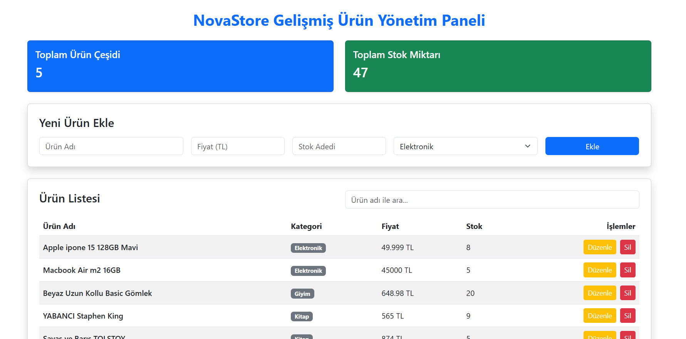

# NovaStore - Ürün Yönetim Sistemi

Bu proje, staj eğitimi kapsamında Node.js, Express.js ve modern web teknolojileri kullanılarak geliştirilmiş bir Ürün Yönetim Paneli ve REST API projesidir.

## Özellikler
* Ürün ekleme, listeleme, güncelleme ve silme (CRUD) operasyonları.
* Kategori filtreleme ve gerçek zamanlı arama.
* Toplam ürün çeşidi ve toplam stok miktarı istatistikleri.
## Ekran Görüntüsü



## Kurulum ve Çalıştırma

Projeyi yerel bilgisayarınızda çalıştırmak için şu adımları izleyin:

1. Projeyi bilgisayarınıza klonlayın veya indirin:
   ```bash
   git clone <github-repo-linkiniz>